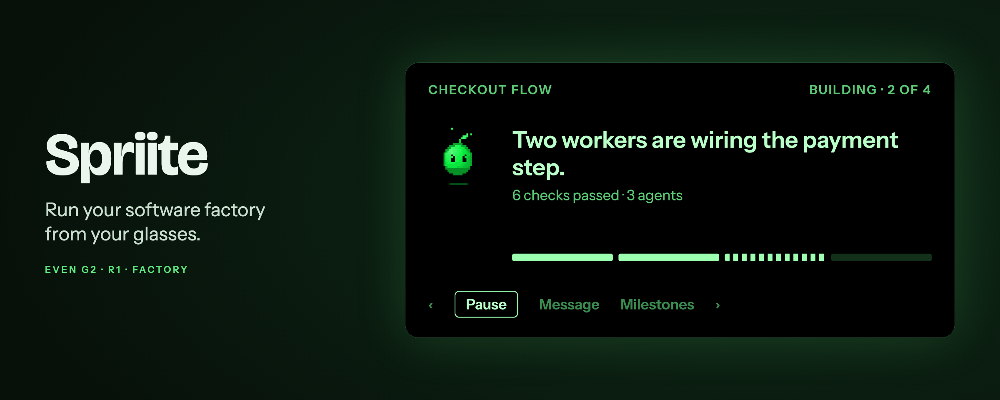
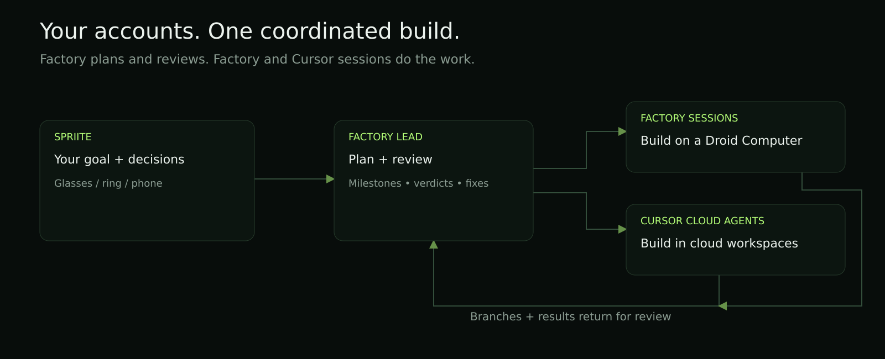
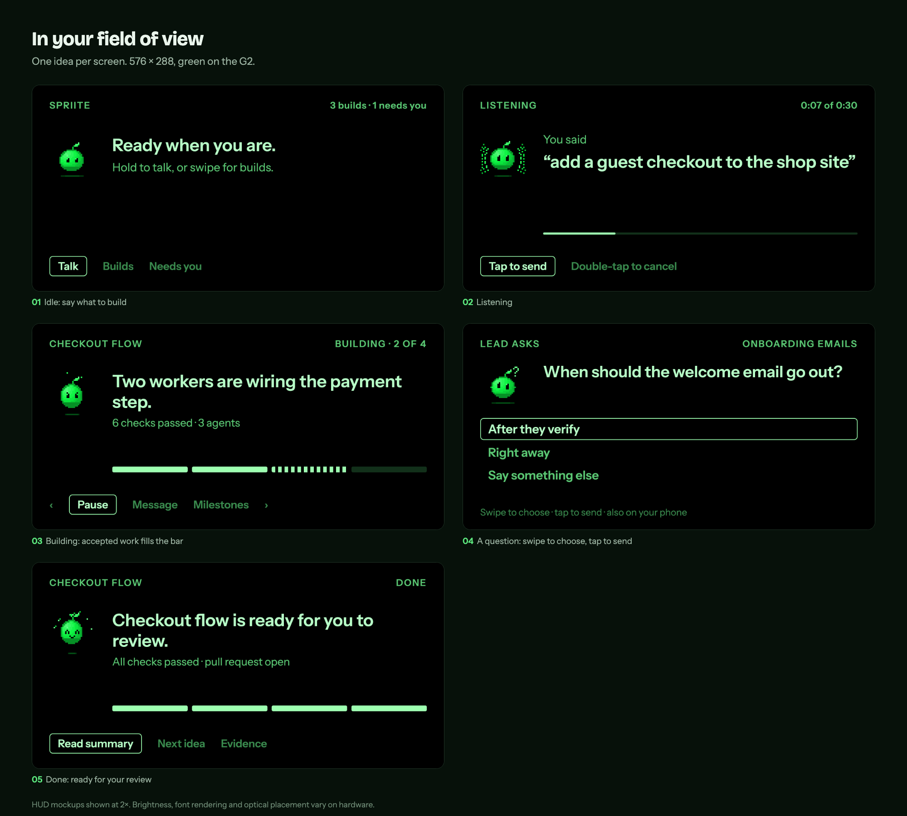
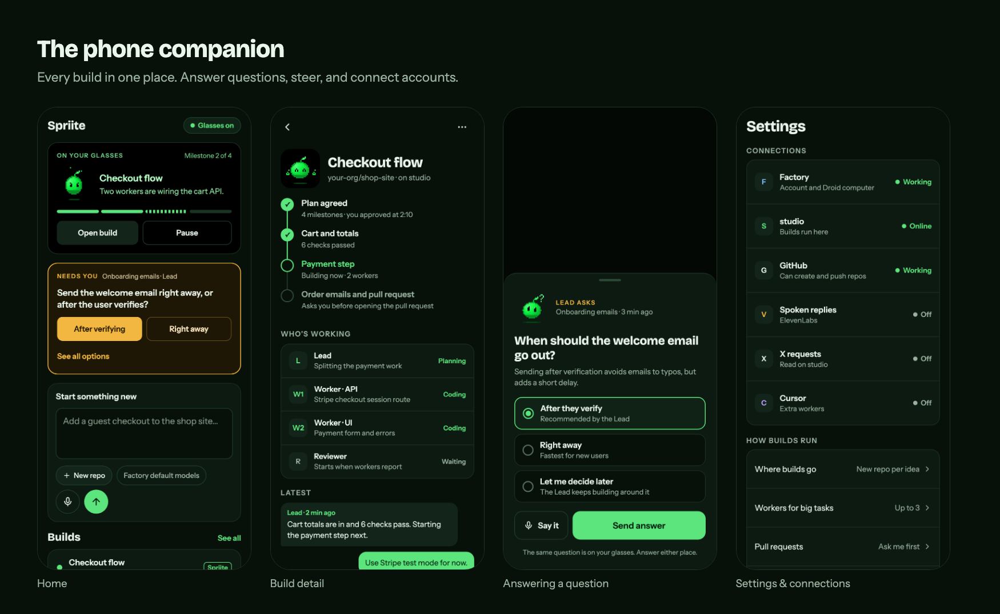
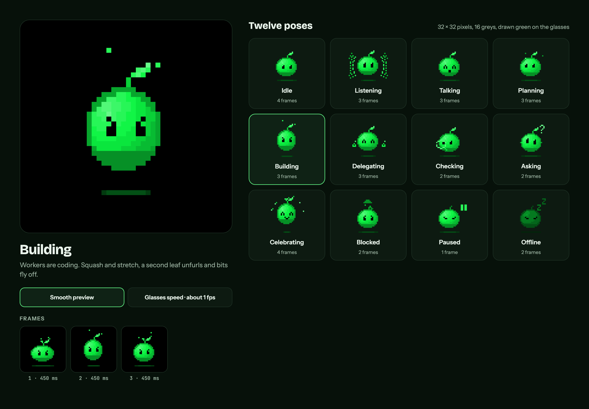

<p align="center">
  
</p>

<h1 align="center">Spriite</h1>

<p align="center"><strong>Run your software factory from your glasses.</strong></p>

<p align="center">
  <a href="#how-it-works">How it works</a> ·
  <a href="#get-started">Get started</a> ·
  <a href="docs/SETUP.md">Setup guide</a> ·
  <a href="CONTRIBUTING.md">Contribute</a>
</p>

<p align="center">
  <a href="LICENSE"></a>
  <a href="https://www.evenrealities.com/"></a>
  <a href="https://factory.ai/"></a>
</p>

Tell Spriite what to build. A Factory lead session turns your goal into milestones, delegates them to **Factory sessions and Cursor cloud agents**, and reviews the work as it lands. Your glasses show the progress, the next decision, and a small hovering companion.

Use your own accounts and GitHub repositories. Speak to steer a mission, tap the ring to answer a question, and open the phone companion when you need more detail.

## How it works



1. **Say the goal.** “Add dark mode to the settings page.”
2. **Review the plan.** Factory drafts weighted milestones. You confirm before workers start using your credits.
3. **Let the workers build.** Run one worker or up to four in parallel, on separate branches. Choose Factory, Cursor, or a mix.
4. **Review as work lands.** Factory inspects each branch and returns a verdict. Failed work goes back to its worker with the reasons.
5. **Integrate the result.** Accepted branches come together for a final review. Open a pull request automatically or confirm first.

**Progress means accepted work.** A submitted milestone stays pending until its review passes. Repairs earn no extra credit; a regression visibly takes its credit back.

Factory is the lead and reviewer in the current connected implementation. Factory sessions run on your chosen Droid Computer—your own connected machine or a Factory-managed cloud computer. Cursor workers run in Cursor cloud workspaces.

## In your field of view



Spriite listens, plans, checks, and asks short questions. Its pixel character hovers, blinks, and changes pose with the mission. The HUD keeps code and logs out of the conversation; milestones and decisions get the space.

| Control | What you do |
|---|---|
| **Voice** | Tap Talk, say a goal or instruction, then tap again to finish. “Hey Spriite” wakes it during voice capture. |
| **Ring or temple** | Swipe between actions, tap to choose, double-tap to go back. At home, double-tap opens the system exit dialog. |
| **Phone** | View the mission and activity, type an instruction, connect accounts, and set worker preferences. |

Consequential voice commands show a readback before they run. The phone also lists existing Factory and Cursor builds; you can monitor them and steer those that support messages. Closing Spriite preserves the mission for the next launch. Pausing stops the orchestrator; an already running worker continues in the background.





<sub>Mockups from the design source of truth, with an illustrative mission; not captured lens footage. The HUD follows the app’s 576 × 288 layout and its pixel frames. Font rendering, brightness, and optical placement vary on hardware.</sub>

## Get started


Spriite is bring-your-own-everything: you host a small relay, run the Spriite host on your Factory computer, and build your own copy of the app for your Even Hub account. The [setup guide](docs/SETUP.md) walks through it step by step:

0. **Get ready.** G2 glasses, a Linux or macOS computer with Node 22, Factory's `droid` signed in, `gh auth login`, and Tailscale on the computer and the phone.
1. **Deploy your relay** to Cloudflare (`npx wrangler deploy` in `relay/`) or your own server.
2. **Install the Spriite host** on your Factory computer: `MODELS='["<model-id>"]' EXPOSE=tailscale bash scripts/install-native-broker.sh`.
3. **Build your copy** with your relay and host URLs: `npm run pack`.
4. **Install it** by uploading `spriite.ehpk` to your Even Hub project.
5. **Pair.** On the computer, run:

   ```bash
   npm run pair -- --relay https://<your-relay>
   ```

   It reads the Factory login, GitHub CLI, Droid computer and host link, and shows a short code (like `K7Q-2MF`) and a QR code. Type the code on the phone and everything comes over end-to-end encrypted. The code works once and expires after 10 minutes.
6. **Choose where builds go.** A new private repo per idea, created with your computer's GitHub sign-in, or one you pick or paste.

Only have a Factory key? Choose **Use my Factory key only**: builds run in Factory's cloud, without the computer step. A new phone takes one transfer code (**Settings › Move to another phone**).

| You need | For |
|---|---|
| **Even Realities G2** | The HUD. The R1 ring is optional; temple controls also work. |
| **Factory account** | Planning, review and Factory workers, on your computer or in Factory's cloud. |
| **GitHub** | Repositories, branches and pull requests. `gh auth login` on the computer is enough. |
| **Your own HTTPS relay** | Installed builds reach Factory, Cursor and X, and pair with your computer, through a small relay you host. |
| **Tailscale** | A private HTTPS link from the phone to the Spriite host on your computer. |
| **ElevenLabs key** | Optional spoken replies and live speech-to-text. |
| **Cursor API key** | Optional cloud workers. |

For a local preview:

```bash
git clone <repository-url> spriite
cd spriite
npm install
npm run dev
```

Open the local page: Welcome offers pairing with your Factory computer, a Factory key only, or moving from another phone. To use the glasses simulator, run `npm run sim` in another terminal while the dev server is running.

**[Follow the setup guide →](docs/SETUP.md)** for every step, from prerequisites to your first build. The Spriite host on your computer is the [native broker](docs/NATIVE-BROKER-SETUP.md); [how pairing is encrypted](docs/design/PAIRING-PROTOCOL.md).

## Your keys, your setup

The app runs in the glasses’ paired phone app. Keys are saved on your phone; pairing and moving phones carry them end-to-end encrypted with a one-time code (a PAKE, so the relay cannot read or guess them). The relay forwards requests to Factory, Cursor, and read-only X and logs nothing; its pairing mailbox holds only ciphertext, for at most 10 minutes. Agent execution and speech transcription still use the providers you connect.

Factory workers use the GitHub credentials on their Droid Computer. Cursor workers use the GitHub access configured in Cursor. With a paired computer, new repositories are created with the computer's own GitHub sign-in, so the phone needs no GitHub token; a token saved on the phone is only the fallback for key-only setups.

[Privacy](PRIVACY.md) · [Security](SECURITY.md) · [Relay details](relay/README.md)

## Build with us

TypeScript + Vite, with an Even Hub device adapter. The mission engine, scene contract, and phone companion are separate from the hardware layer, so other HUD glasses can be supported with an adapter.

[Development guide](docs/DEVELOPMENT.md) · [Qualification](docs/QUALIFICATION.md) · [Contributing](CONTRIBUTING.md) · Report issues on the repository's issue tracker

---

Built in **[Factory](https://factory.ai/)**.

Apache License 2.0 · [License](LICENSE) · [Notice](NOTICE)

