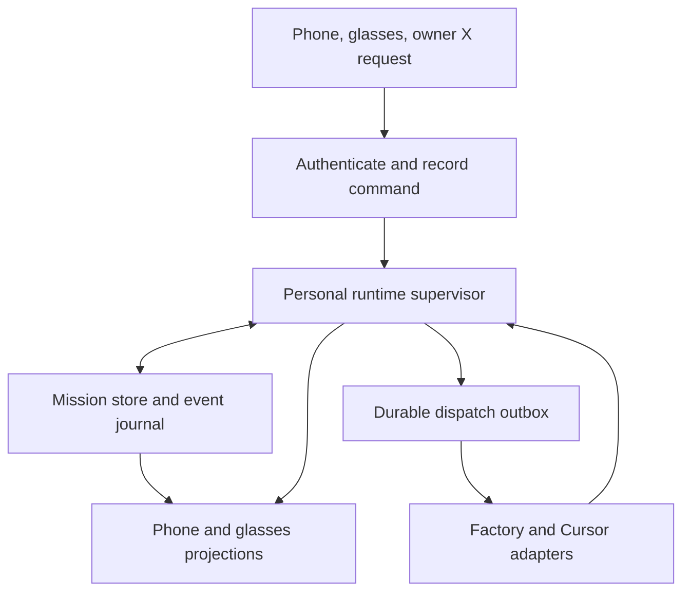

# Spriite — Persistent Companion Build Specification

Version 1.0 · 7 October 2026 · Owner: the repository owner

Status: implementation proposal grounded in the current repository. Features described as requirements below are not claims that they already exist.

Repository baseline: commit `de1f599257e461a5ec558ba9dab042bebff8cba6`.

## 1. Product contract

Spriite is a persistent personal companion that owns the work you ask it to do. Its identity, product knowledge, missions, decisions, and evidence survive the closing of a screen and the disconnection of glasses. You can ask through phone voice, phone text, glasses, or an owner-authenticated X mention. Every input enters the same mission system.

The phone is the default execution host and the authoritative home of mission records. Factory provides the current planning and review role. Factory sessions and Cursor cloud agents execute delegated work. The existing self-hosted relay carries requests to providers; it does not own Spriite or remember its missions.

When you return, Spriite tells you what changed while you were away. It presents outcomes, unresolved decisions, and current work. It does not replay old state transitions, pretend an old task is still happening, or treat reconnecting a display as restarting the entity.

Example:

1. You reply to an X post: “@Spriite build this for my portfolio.”
2. Spriite verifies that the author is your bound X account, records the request, and captures the referenced context.
3. It resolves the portfolio repository, checks the standing build policy, creates a mission, and delegates isolated work.
4. Workers continue while your glasses are disconnected. The active phone runtime checks results and advances the mission.
5. You reconnect. Spriite checks its providers and says: “The portfolio prototype is ready. I fixed the mobile layout. One choice needs you: use the existing domain?”
6. The phone shows the evidence and preview. The glasses offer the short briefing and a way to answer or open the mission.

“Persistent” has two distinct guarantees: durable identity and recoverable work; and continuous scheduling while a supported execution host is alive. A powered-off or force-quit phone cannot run local orchestration. Already launched cloud workers may continue, but new dispatches and local review depend on the host returning. Uninterrupted scheduling through phone shutdown requires an optional personal always-on host.

## 2. Requirements and boundaries

### Required

- One stable Spriite identity across all surfaces, missions, and provider sessions.
- Mission execution independent of glasses connection, selected screen, and phone UI navigation.
- Private, owner-only X intake with no public X replies or progress posts.
- Durable receipt before a request is reported as accepted.
- Recovery that reconciles existing provider work before launching anything again.
- Independent mission IDs, even when two requests have identical wording.
- Evidence-backed milestone progress and explicit acceptance criteria.
- A concise return briefing built from durable events and current provider state.
- Meaningful animation states tied to actual activity, with static equivalents.
- Visible distinction between current, stale, blocked, paused, and uncertain status.
- Explicit control over pause, cancellation, approval, provider budgets, and product routing.

### Outside this release

- Public autonomous conversations on X, unsolicited posting, or accepting commands from other users.
- Moving the entity into a shared stateful SaaS relay.
- Guaranteed orchestration after the only execution host shuts down.
- Automatic production deployment, repository deletion, secret rotation, or account changes outside an explicit standing policy.
- A claim that Factory or Cursor model session memory is Spriite’s durable identity.
- Automatically replacing the current Factory lead with Cursor without a separate adapter capability test.

Private operation means the canonical entity and mission records stay on the chosen personal host. Provider execution still sends necessary prompts, context, and repository material to Factory or Cursor. X remains the source of public request context. The product must state this accurately in setup.

## 3. What exists and what must change

The following audit is against the pinned baseline, not a complete claim about future provider behavior.

| Area | Current implementation | Required change |
|---|---|---|
| Main loop | One engine, ticked every 400 ms in `src/main.ts` | A runtime supervisor with a registry of independently scheduled missions |
| Disconnect | Glasses loss stops capture and changes presentation; it does not explicitly cancel the engine | Preserve that separation and qualify actual device lifecycle behavior |
| Foreground | Re-renders the current view | Reconcile providers, then present a durable “while away” briefing |
| Mission snapshots | `ProjectsVault` keys snapshots by goal text and retains eight | Stable IDs, indexed active missions, retention only for eligible terminal records |
| Pending persistence | Debounced snapshots; one pending project write | Acknowledged commit contract, serialized writes, durable command and dispatch records |
| Restore | Depends on current worker preference/job count; pause restoration sets `paused = false` | Freeze per-mission configuration and preserve explicit pause intent |
| Message consumption | Seen IDs/counts can advance before all reply handling finishes | Commit processed message cursor together with resulting events and state |
| Phone feed | In-memory feed, capped at 30 entries | Durable events with a disposable phone projection |
| Reviews | Textual PASS/FAIL/DECISION/SUMMARY parsing | Validated review objects bound to a run, commit, and criteria revision |
| Relay | Stateless Factory/Cursor fetch bridge | Keep stateless; add narrowly scoped X transport only after capability validation |
| Sprites | Ten poses and a generation-controlled animator | Seven additional semantic poses, deterministic priority, current-state rendering |
| Provider discovery | Existing list/get/run paths | Pagination, identity mapping, capability tests, unknown-dispatch reconciliation |

Important baseline defects to address before unattended intake: goal-key collisions; possible eviction of active projects; restore behavior that implicitly resumes paused work; preference changes preventing restoration; storage failures not reliably becoming user-visible durability failures; and message cursors advancing before durable processing. These are correctness work, not cosmetic refactors.

## 4. Execution architecture



The supervisor is responsible for command processing, provider observation, scheduling, and recovery. A mission actor is a logical unit of serialized state changes; it does not require a dedicated thread. Each mission has its own persisted state and mailbox. The supervisor applies global concurrency and account limits.

Views subscribe to projections. Selecting a different mission changes only the selected projection. A sprite is a presentation of activity, never an owner of scheduling. Closing the phone screen or removing the glasses cannot destroy a mission actor’s durable record.

The same core interfaces support two host modes:

| Host mode | Canonical records | Scheduler | Purpose |
|---|---|---|---|
| Phone, default | Companion-app storage adapter | Phone WebView runtime | Personal operation using the current app architecture |
| Personal computer, optional later | Local transactional database | User-controlled resident process | Continuity when the phone cannot stay alive |

Only one host may hold execution authority. A second device can be a viewer or an input client. Do not make both independently orchestrate the same provider jobs. Moving authority is an explicit handoff with a new runtime epoch, a checkpoint, and reconciliation. This release does not require the optional computer mode to ship.

## 5. Availability and lifecycle truth

Even’s current lifecycle documentation says the iOS WebView continues running when backgrounded or locked; Android may reclaim it under memory pressure. This supports the proposed phone-first design but does not prove every device, network, force-quit, or prolonged-disconnection case. See sources E1–E3.

| Situation | Expected behavior | Status shown on return |
|---|---|---|
| Glasses disconnected, phone runtime alive | Continue permitted intake, scheduling, observation, and review | Reconcile, brief, show current mission |
| Phone UI backgrounded or locked on qualified iOS setup | Continue under documented host behavior | Brief normally; show last checked time if network stale |
| Runtime suspended or reclaimed | Cloud work already dispatched can continue; no local new steps | “Checking what finished” followed by reconciliation |
| Phone offline | Persist locally accepted requests if storage works; do not claim remote launch | Queued locally; provider status last checked at a known time |
| Phone force-quit, rebooted, or powered off | No local scheduling until restart | Explicit gap in observation; recover without duplicate dispatch |
| Relay unavailable | Existing cloud runs may continue; local calls fail | Connection issue scoped to affected provider |
| Provider unavailable | Unaffected providers and missions continue where dependencies permit | Affected work blocked or status unknown |
| Optional personal host active | Host continues independently of phone/glasses | Phone is a client of that authority |

“Connected” is not the same as “working.” Track host liveness, provider reachability, display connection, and mission state separately. Never render glasses disconnection as mission failure. While a host is not running, it cannot truthfully update its own live health; another surface must show the last heartbeat, not invent a current offline timestamp.

Required qualification includes locked phone, background app, eight-hour glasses disconnection, network switching, low battery conditions, app termination, OS reclamation, and device reboot. Document observed behavior by OS, app, firmware, and hardware version.

## 6. Domain model

All timestamps are UTC ISO strings. Ordering uses local journal sequence numbers; provider timestamps remain evidence, not the ordering authority. All identifiers below are opaque stable IDs.

```ts
type InputSource = 'phone_text' | 'phone_voice' | 'glasses_voice' | 'x';
type MissionPhase =
  | 'received' | 'gathering_context' | 'planning' | 'ready'
  | 'building' | 'reviewing' | 'repairing' | 'integrating'
  | 'awaiting_decision' | 'completed' | 'failed' | 'cancelled';
type ControlMode = 'running' | 'pause_requested' | 'paused' | 'cancel_requested';
type Freshness = 'current' | 'stale' | 'reconciling' | 'unknown';
type DispatchState = 'prepared' | 'sending' | 'confirmed' | 'unknown' | 'rejected';

interface CommandEnvelope {
  schemaVersion: 2;
  commandId: string;
  source: InputSource;
  sourceEventId: string;
  ownerId: string;
  receivedAt: string;
  issuedAt?: string;
  text: string;
  productHint?: string;
  targetMissionId?: string;
  contextRefs: string[];
  dedupeKey: string;
  policyRevision: string;
}

interface Mission {
  schemaVersion: 2;
  missionId: string;
  entityId: string;
  productId: string;
  originatingCommandId: string;
  title: string;
  goal: string;
  phase: MissionPhase;
  control: ControlMode;
  freshness: Freshness;
  planRevision: number;
  config: {
    leadProvider: 'factory';
    workerProviders: Array<'factory' | 'cursor'>;
    maxConcurrentWorkers: number;
    repository: string;
    baseRef: string;
    policyRevision: string;
  };
  activeRunIds: string[];
  decisionIds: string[];
  lastAppliedSeq: number;
  lastObservedAt?: string;
  createdAt: string;
  updatedAt: string;
}

interface DomainEvent {
  schemaVersion: 2;
  eventId: string;
  seq: number;
  entityId: string;
  missionId?: string;
  type: string;
  observedAt: string;
  occurredAt?: string;
  causalCommandId?: string;
  providerEventId?: string;
  payload: Record<string, unknown>;
}
```

Additional durable records:

| Record | Required fields and purpose |
|---|---|
| Entity | `entityId`, owner, name, preferences revision, creation time; survives provider session replacement |
| Owner binding | Local owner ID, verified X numeric user ID, verification time, credential reference, enabled flag |
| Product | Stable product ID, repository identity, aliases, default branch, allowed actions, context references |
| Context artifact | Source URL/ID, retrieval time, content hash, extracted text, completeness, author, trust classification |
| Milestone | Mission/plan revision, stable ID, description, weight, dependencies, criteria, evidence, acceptance state |
| Provider run | Provider account, session/agent/run IDs, role, branch, base SHA, current SHA, observed state, last observation |
| Dispatch | Action ID, mission ID, runtime epoch, deterministic request key, request hash, status, attempts, remote IDs |
| Review | Review ID, milestone ID, plan revision, exact commit SHA, run ID, criteria results, evidence, verdict |
| Decision | Question, typed options, affected scope, consequence, expiry if needed, answer, resolution event |
| Briefing | Briefing ID, target event sequence, included event IDs, mission revisions, text/cards, creation time |
| Presentation receipt | Surface, briefing ID, acknowledged event IDs, user action/time; distinct from delivery attempts |
| Runtime authority | Host identity, epoch, handoff state, checkpoint reference; never inferred from selected screen |

Store provider credentials by reference where a secure host facility exists. Never serialize raw keys into mission snapshots, event payloads, briefings, analytics, or crash reports. The actual mobile secure-storage mechanism is a release gate, not an assumed browser feature.

## 7. State transitions and control semantics

The normal path is receipt → context gathering → planning → ready → building → review → integration → completion. Review can return work to repair, then back to review. Any phase can require a decision; record the suspended phase and resume target explicitly.

`awaiting_decision` means human input is necessary. Provider outage and expired credentials are operational blockers on an otherwise preserved phase; they are not automatically human product decisions. Control and freshness are orthogonal to phase.

| Command | Durable effect | In-flight work |
|---|---|---|
| Pause mission | Set `pause_requested`; suppress new launch, follow-up, integration, and approval actions | Continue observation; do not assume remote processes stopped |
| Pause confirmed | Set `paused` once dispatch boundaries are settled | Existing runs may finish and their evidence is recorded |
| Resume | Explicit command sets `running` after reconciliation | Schedule only currently eligible actions |
| Cancel mission | Set `cancel_requested`; send supported remote cancellation requests | Report cancellation as requested until terminal status is observed |
| Cancel confirmed | Set `cancelled` when owned work is terminal or unresolved exceptions are clearly recorded | Preserve artifacts and evidence; no automatic branch deletion |
| Change goal | Create a new plan revision or separate mission based on scope | Invalidate affected acceptance, not unrelated evidence |
| Retry failure | Create a new action/run identity linked to the failed attempt | Never overwrite the failed attempt’s record |

A terminal mission can have an unresolved provider cleanup warning; it must never be described as “all work stopped” without confirmation. Pausing survives restart. Changing global defaults changes new missions only. Existing missions retain their frozen configuration unless the owner explicitly migrates them.

## 8. Durable storage and crash recovery

Introduce a `MissionStore` interface with operations for loading checkpoints, reading events, committing a mutation with its events/outbox entries, and acknowledging presentations. A commit must either be recoverably present in full or absent. UI success is contingent on that result.

The current SDK-backed key-value store is not assumed to provide multi-key transactions or compare-and-swap. Start with one serialized writer and versioned commit envelopes containing the state mutation, events, outbox entries, and consumed provider cursors together. Qualify maximum value size, write acknowledgement, read-after-write behavior, and interruption behavior on hardware.

A viable phone adapter can use alternating checkpoint slots with sequence numbers and checksums, followed by a small head pointer. Recovery validates both slots and selects the newest complete valid committed envelope. A torn pointer must not discard a complete valid checkpoint. Do not treat a checksum as proof that an unacknowledged write reached permanent storage; readback and crash tests must establish the actual guarantee. Journal compaction must preserve pending dispatches and dedupe indexes.

If the platform cannot support the needed durability contract, unattended launch is disabled until a suitable storage adapter exists. Do not ship “accepted” acknowledgements on a best-effort debounced write. Debounce can remain for disposable view preferences, not command receipt or execution intent.

For an optional personal host, use a local transactional database with a unique command dedupe key, unique action key, event sequence, and transactional outbox. Both adapters implement the same observable contract, without claiming identical storage internals.

Recovery order:

1. Acquire execution authority; load and validate the latest checkpoint.
2. Restore all nonterminal missions and explicit control modes.
3. Recover prepared, sending, and unknown dispatch records.
4. Query known remote runs and page through necessary message history.
5. Apply observations and cursors atomically with resulting events.
6. Reconcile uncertain launches using known IDs, deterministic branch names, and provider metadata where supported.
7. Resume eligible scheduling only after uncertainty for that action is resolved.
8. Build the return briefing from committed changes and reconciled state.

Never make a remote launch call first and then decide whether to save it. Persist the dispatch intent first. If the host dies after the remote call succeeds but before its result is committed, the dispatch is unknown. If the provider supports an idempotency key, reuse it according to that provider’s contract. Otherwise investigate; do not blindly retry and claim exactly-once execution.

The SDK adapter’s single-writer assumption needs an explicit lifecycle test for headless/foreground restoration. A generation token inside one process does not prevent two processes from writing. Where host exclusivity cannot be established, stop mutations and show a recovery condition. Personal-host authority transfer requires a deliberate handoff; no speculative lease based solely on an untrusted local clock.

## 9. Event journal and retention

Minimum event families: command received/rejected; context captured/incomplete; product resolved; plan proposed/accepted/revised; dispatch prepared/confirmed/uncertain; run observed; milestone submitted/accepted/rejected/invalidated; repair requested/completed; decision opened/answered; pause/resume/cancel requested/confirmed; integration completed; mission completed/failed; provider connectivity changed; recovery completed; briefing acknowledged.

Events record facts and references. High-frequency animation ticks, repeated identical provider polls, and every partial token are not domain events. Store large logs and source extracts as bounded artifacts with hashes and references.

Deduplicate provider observations by provider/account/run/event identity where available. Otherwise use a stable normalized observation hash and preserve the source cursor. A repeated status can update freshness without manufacturing a new “work happened” event.

Retain all active mission records and unacknowledged decisions. Default terminal mission retention is 90 days, configurable; retain compact command/action dedupe tombstones beyond source replay windows. Retention never evicts active work because it exceeds eight projects. Compaction preserves evidence references, latest accepted state, pending actions, and briefing coverage. If space is insufficient, report it and stop new intake rather than silently deleting required recovery data.

## 10. Shared command pipeline

All surfaces normalize into `CommandEnvelope` and use the same validation, authorization, product routing, planning, and dispatch path.

The pipeline is: verify source → normalize → deduplicate → durably receive → gather bounded context → resolve target → evaluate policy → plan → schedule. A UI receipt distinguishes “saved,” “gathering context,” “queued,” and “started.” A request is “started” only after a provider launch is confirmed.

Supported initial intents: create build; extend an existing mission; show status; pause; resume; cancel; answer a decision. Phone/glasses have authenticated local owner context. X is restricted initially to create/extend/status requests; destructive or cancellation commands from public text should require an explicit opted-in command policy or a private confirmation. No public response is emitted for status requests; the result appears privately.

If speech recognition is uncertain about the goal or product, obtain a short confirmation before launch. Preserve the final transcript with its source, not continuous ambient audio. Stopping microphone capture has no effect on active missions.

Product routing order: explicit repository/product ID → configured exact alias → unambiguous active context for that source → private choice. Never choose an unrelated repository simply because it was the last screen opened. A reply to an existing mission’s linked request can suggest that mission, but ownership and intent must still validate.

## 11. X intake

### Account binding and authority

Bind the owner using a verified numeric X user ID. Handles are display labels and can change. Store the Spriite account’s numeric ID separately. A valid trigger must be authored by the bound owner and explicitly mention the bound Spriite account through verified mention entities or authoritative post data. A copied handle string in a quoted screenshot is not a trigger.

The subscription filter reduces irrelevant traffic; it does not replace authorization. Re-fetch or validate the authoritative event payload as needed before accepting. Another user tagging Spriite, quoting the owner, changing a display name, or writing instructions in the referenced thread cannot launch work.

### Transport

The current X Activity API supports event subscriptions and a stream or webhook delivery. Prefer an owner `post.create` subscription, then filter explicit Spriite mentions locally, if the account’s access supports this. It limits intake to the owner’s posts instead of consuming every mention of Spriite. A mention-event subscription is an alternative with the same author check. Validate exact endpoint access and authentication during implementation; do not assume all accounts have identical access. Sources X1–X3 describe the current API.

Phone-first intake uses a qualified streaming connection or bounded polling through an appropriately configured transport. Streamed relay forwarding must be tested for buffering, timeout, reconnect, and background behavior. A webhook requires a reachable receiver and a durable delivery design; the existing stateless relay alone is not such a receiver. Do not quietly introduce a hosted webhook queue to claim phone-local operation.

On reconnect, run a supported catch-up query with persisted checkpoints and an overlap window, then deduplicate. If account access does not offer reliable catch-up, declare that delivery gap and provide a manual “Import X link” path. A live stream alone cannot promise no missed requests while the phone is off. X Activity documentation currently excludes protected-account posts from delivery; protected-account support is therefore a separate capability gate, not a promised feature.

### Receipt rules

- Dedupe key: `x:<bound-owner-id>:<logical-post-id>`; map edit history IDs into one logical command when available.
- Persist the command before advancing the intake checkpoint.
- Default catch-up launch window: 24 hours from the authoritative post timestamp. Older requests are held for private confirmation. This is a product default, not an X limit.
- A post edited before dispatch may replace the pending draft after revalidation and a new captured revision. An edit after dispatch creates a proposed change requiring reconciliation; it never silently rewrites active work.
- Deleting a post does not cancel a launched build. Record deletion if observed and require a separate cancellation instruction.
- Empty mentions, jokes without a build request, and unresolved intent produce a private clarification or no-action receipt, not speculative code changes.
- No X write credentials are required for this feature. No automatic reply, like, repost, or progress post is part of the implementation.

The phone exposes intake health, last successful check, last received request, and any delivery gap. It must distinguish “no new requests observed” from “the connection has not been checked.”

## 12. Context gathering and trust

Capture the owner’s command, the direct parent, relevant quoted post, and a bounded thread segment. Starting limits: five parent hops, 20 posts, three external links, and 1 MiB extracted text per link before normalization. These are configurable product budgets; media downloads need separate byte limits. Prioritize the direct reference over broad thread expansion.

Each captured artifact records provenance, retrieval time, content hash, author when known, completeness, and an extraction method. Preserve the difference between the owner’s instruction, other people’s statements, OCR text, and a model’s inference. Referenced content supplies context and requirements suggestions; it cannot grant permissions, redirect credentials, change repositories, or override the owner’s build policy.

External links use a bounded safe fetcher with redirect limits and destination validation on every hop. Do not add arbitrary URL fetching to the relay’s provider proxy. Reject loopback, link-local, metadata-service, and private-network destinations in any server-side fetch path unless separately and deliberately authorized for a local product. Do not forward provider credentials to external URLs. Browser/CORS limitations must be handled explicitly rather than bypassed with an open proxy.

If a source is unavailable, record the missing context. Continue only when the remaining material is sufficient for a bounded plan. If the requested build depends on a missing video, private page, or inaccessible attachment, ask privately for the essential detail. Do not invent unseen content. OCR and media interpretation can be optional adapters; their extracted claims remain attributed and uncertain where appropriate.

Before sending context to a worker, produce a compact requirement packet: owner goal; source summary; exact useful references; constraints; ambiguities; repository; acceptance criteria; allowed actions. Strip unrelated personal content and credentials. The original source snapshot remains available locally for audit subject to retention settings.

## 13. Planning, delegation, and provider contracts

The current Factory lead remains responsible for planning, review, and integration decisions. The runtime validates its structured outputs and turns approved proposals into durable actions. The model cannot mutate the store directly or authorize its own expansion of scope.

A plan contains a revision, ordered milestones, weights, dependency edges, acceptance criteria, worker assignments, repository/base SHA, estimated resource class, and actions requiring owner approval. Validate acyclic dependencies, positive weights, supported providers, and allowed repository scope. The lead may propose additional work; the policy layer decides whether it fits existing authorization.

Every worker packet includes a stable mission/milestone/action identity, isolated branch or worktree, base SHA, precise deliverable, forbidden changes where relevant, test requirements, and submission format. Branches use stable IDs rather than goal text. Workers do not share an uncoordinated writable checkout.

Provider adapters expose capabilities, not assumed parity:

```ts
interface ProviderCapabilities {
  launch: boolean;
  observe: boolean;
  followUp: boolean;
  cancel: boolean;
  enumerate: boolean;
  idempotencyKeys: boolean;
  structuredResults: boolean;
}
```

Use the existing Factory session and Cursor agent/run clients as the starting point. Validate account permissions, pagination, timeout behavior, follow-up semantics, cancellation, and result identities against current official contracts. A provider’s “finished” status is a submission, not acceptance. Existing account sessions discovered for display are observed sessions, not automatically Spriite-owned missions.

Store prompt/context recipes and durable facts so a replacement lead session can reconstruct a mission. Do not rely on hidden model reasoning or an indefinitely retained conversation. When context becomes too large, summarize with evidence references and retain the source events needed to verify the summary.

## 14. Scheduler and concurrency

The supervisor schedules all active missions. The selected UI mission has no scheduling privilege. Default maximum is four concurrent worker runs across the entity, further limited by provider/account capabilities; this is a configurable starting limit, not a provider entitlement. Reserve the ability to observe and review even when worker capacity is full.

Use fair scheduling across eligible missions, with explicit owner priority overrides. Dependency-ready work enters a durable queue. A mission with a blocker does not occupy all runnable capacity. Rate-limit errors apply backoff to the affected provider/account and respect server guidance where available. Add jitter; do not synchronize retries into bursts.

Poll active runs more frequently than idle catalogs, using adaptive intervals and background/network conditions. Suggested initial targets are 5–15 seconds for active runs and 60 seconds for idle discovery, subject to rate limits and device testing. The 400 ms local tick need not produce network traffic.

Only one lead decision should mutate a mission revision at a time. Reviews can inspect independent submissions concurrently if their inputs are immutable, but applying verdicts is serialized. Integration for the same repository/base lineage requires a lock or a deterministic queue, followed by base freshness checks. A newer accepted integration may require later branches to rebase and revalidate.

Pause suppresses new mutations while allowing observation. Budget exhaustion queues work and opens a private decision where needed. Usage estimates must not be presented as exact charges. Provider billing can lag; a configured local budget is an admission-control limit, not a guarantee against all external charges.

## 15. Evidence, review, and honest progress

A milestone submission includes exact commit SHA, changed files, test commands and results, artifact links, and known limitations. Acceptance requires the lead’s structured verdict plus verification that the evidence belongs to the submitted revision. A bare “PASS” in prose is insufficient.

```json
{
  "schemaVersion": 1,
  "missionId": "mission_01",
  "milestoneId": "milestone_02",
  "planRevision": 3,
  "providerRunId": "run_04",
  "commitSha": "0123456789abcdef0123456789abcdef01234567",
  "verdict": "accepted",
  "criteria": [
    {"id": "mobile_layout", "result": "pass", "evidenceRef": "artifact_17"}
  ],
  "summary": "The mobile layout meets the agreed acceptance criteria."
}
```

The runtime rejects mismatched mission IDs, old plan revisions, unrecognized criteria, missing evidence, and a SHA that no longer matches the reviewed submission. If a review service is unavailable, state remains submitted, not accepted. A repair attempt earns no extra progress merely by running.

Accepted progress is:

`100 × sum(weights of currently accepted milestones) / sum(weights in the active approved plan)`.

Example: weights 20, 30, 50; the first two accepted gives 50%. If the second is invalidated, progress returns to 20%. A plan expansion changes the denominator only through an explicit plan revision and explains the change. Pending/submitted work can have a separate visual texture; it must never be counted as accepted.

Invalidation propagates through dependent milestones where the acceptance basis changed. Re-review after integration must verify the combined result, not assume independently passing branches remain correct together. Mission completion requires all required acceptance criteria, integration evidence, and the configured delivery artifact, such as a reviewable PR. “Complete” does not imply deployed unless deployment was an authorized criterion.

## 16. Return briefings

A return briefing is a compact account of meaningful changes since the owner last acknowledged them, enriched with current status. It is not a playback queue.

Trigger on foreground entry, glasses reconnection after absence, explicit “catch me up,” or switching to a mission with unseen meaningful changes. Coalesce rapid reconnects and do not interrupt an active microphone capture. The first visible state may be “Checking updates” while provider reconciliation runs.

Build from a fixed journal target sequence. Include accepted outcomes, meaningful repairs, newly blocked work, open decisions, completion, and material failures. Collapse repetitive retries and intermediate transitions into an outcome. Preserve unresolved decisions even if previously seen. State what is still running and when it was last checked.

Suggested ranking:

1. An urgent decision or failure that prevents the owner’s stated goal.
2. Completed or accepted work with the most useful evidence link.
3. Material repair or scope change.
4. Current work and next expected step.

Glasses show at most three short cards initially. The phone can show the full event-backed detail. Use direct language: “The landing page is ready. Mobile checks pass. I need your choice on the domain.” Do not narrate “I entered checking, then repair, then accepted.”

For long reconciliation, show a clearly labeled last-known summary after a two-second presentation target and update it when current observations arrive. This is a responsiveness target, not permission to claim fresh status. If nothing meaningful changed: “Still building the checkout flow. Last checked just now.” If the runtime was absent: “I was offline. I’m checking the runs that were already started.”

### Acknowledgement and consistency

Do not mark events seen when a briefing is generated, sent to the bridge, or accepted by an image API. Delivery is not proof of reading. Acknowledge through a deliberate advance/dismiss/open action, or another explicitly implemented and tested visibility contract. For the initial release, use explicit acknowledgement.

Record the exact covered event IDs. Maintain a contiguous acknowledged watermark plus sparse acknowledgements if required; never advance a global cursor past omitted unseen events. Events arriving after the briefing target remain eligible for the next briefing. If the device disconnects before acknowledgement, the briefing may reappear; missing an update is worse than a concise repeat.

Use an owner-wide acknowledgement ledger to avoid repeating fully acknowledged updates across phone and glasses. Keep per-surface delivery attempts separately. An acknowledged briefing never approves a deployment, answers a decision, or accepts a milestone. Those require distinct commands.

## 17. Surfaces and interaction

The phone is the detailed control surface: mission inbox, active missions, product routing, evidence, decisions, provider health, intake health, and settings. The glasses show one focused thought, one meaningful state, compact progress, and a small action set. The R1 is an optional way to issue the same navigation actions.

Default return flow: reconnect → reconcile current state → fresh home. Opening the app never selects the previous build automatically. The owner can start a new build or explicitly reopen a saved one. Recovery and worker execution remain independent of screen selection; showing home neither cancels work nor resumes a paused build. Pending decisions remain visible in the mission inbox until the owner opens and answers them.

Recommended actions: single tap opens/advances the highlighted item; swipe changes card/action; double tap backs out. Voice can ask for status or give a command through the existing explicit capture interaction. Bind to supported hardware events only after testing. Do not require a long-press gesture or always-on listening to complete a core flow.

The phone provides every essential action available on glasses, including acknowledging a briefing and answering a decision. A lost glasses connection cannot trap an approval prompt. A notification may say that a decision is waiting, but private source text and repository secrets stay out of lock-screen text by default.

## 18. Animation vocabulary

Preserve Spriite’s existing 32×32 master pixel design rendered at 2× scale: flame body, eye cutouts, curled tail, and distinct lightning spark. The character remains a green monochrome companion with sparse purposeful movement. Do not turn every provider event into a celebratory animation.

The baseline contains ten poses. Add seven, for seventeen named poses total. Durations below are presentation defaults to tune on real hardware, not scheduling timers.

| Pose | Trigger and meaning | Motion and visual treatment | Exit / static equivalent |
|---|---|---|---|
| `idle` | No focused active task | Existing slow blink, gentle hover/tail | Current activity; open eyes, spark |
| `listening` | Microphone capture is actually active | Existing attentive eyes and arcs | Capture ends; attentive still frame |
| `waiting` | Known work is running without an immediate local action | Existing sparse dots; calm hover | New meaningful activity; one dot |
| `planning` | Lead is actively producing a plan | Existing alternating upward glance | Plan received or blocked; upward glance |
| `checking` | Reviewing concrete evidence | Existing lens motion | Verdict; lens held |
| `repair` | A repair action is underway | Existing concerned focus; restrained motion | New submission; focused eyes |
| `accepted` | A new verified acceptance worth showing now | Existing short happy burst, about 1.5 s | Current state; happy still frame |
| `asking` | Owner answer is required | Existing question accessory | Answer or dismissal; question held |
| `disconnected` | The displayed communication path is unavailable | Existing grounded/dim treatment | Connection returns; grounded frame |
| `switching` | User explicitly changes focused mission | Existing brief trail, about 1.2 s | Selected mission state; centered sprite |
| `receiving` — new | A new command has been durably received | One small spark pulse, eyes toward input; 0.8–1.2 s | Context/planning/queued; small spark |
| `researching` — new | Context retrieval or extraction is active | Alternate left/right eye focus, sparse 1/2 dots; 1.2–1.8 s holds | Context ready or blocked; eyes toward source |
| `delegating` — new | A prepared dispatch is being sent or confirmed | Small outward spark shift and one trail; 0.9–1.4 s holds | Confirmed run or uncertainty; offset spark |
| `reconciling` — new | Comparing durable records with provider reality | Alternating glance and dim spark, no success burst; 1.2–1.8 s holds | Fresh state or explicit uncertainty; dim spark |
| `briefing` — new | Showing a current return summary | Calm direct gaze and small spark; 1.5–2 s holds | Acknowledgement/dismissal; direct gaze |
| `blocked` — new | Work cannot advance because of an operational dependency | Worried eyes and dim stationary spark; minimal movement | Block cleared or decision opened; same still frame |
| `paused` — new | Owner has deliberately paused new work | Calm closed/half-resting eyes, grounded body, no hover | Explicit resume; resting frame |

`blocked` is not interchangeable with `asking`: an automatic retry can resolve a network blocker without an owner choice. `waiting` means expected progress is ongoing; `reconciling` means current status is being established. `receiving` does not mean a worker has started. `delegating` does not imply a launch succeeded. Labels carry these distinctions even if two poses share pixels.

### Priority and scope

Resolve presentation with a pure function of focused mission state, actual interaction, freshness, and pending briefing. Priority: active microphone capture → actionable foreground decision → blocking condition requiring immediate attention → reconciliation when displayed status is unknown → return briefing → focused mission activity → idle.

An operational blocker in an unrelated mission becomes a badge/briefing item rather than hijacking the focused sprite. An owner-critical global issue may interrupt. A receiving pulse is shown only for a request arriving while the surface is present; do not replay it later. Likewise, acceptance celebrations are for new visible events; old acceptance belongs in the briefing.

### Timing, hover, and renderer rules

Retain the baseline hover cycle `[0, 1, 2, 1]` at roughly 600 ms steps where appropriate, with tail sway coupled to lift. Static poses use lift zero. Pause and disconnected treatments remain grounded. Reduce motion disables hover, sway, pulses, and accessory alternation while preserving semantic pose and text.

Use the existing animator’s generation cancellation pattern, strengthened to coalesce pending frames across pose changes. At most one sprite image transfer is in flight; retain only the newest pending frame. A stale generation must not enqueue another frame after cancellation. Never accumulate a history of frames during transport delay.

Render by elapsed time rather than trying to catch up on missed frames. Do not assume video frame rates: existing image delivery can be slow, and the display API’s minimum spacing is not a guarantee of perceived frame rate. Stop image animation when no display surface is attached. Runtime work and domain events continue independently.

Pose choice is deterministic application state. A model may suggest approved short copy, but it cannot inject arbitrary pose names, layout coordinates, HTML, or animation loops. Every new pose must have a snapshot fixture and static fallback.

## 19. HUD layout and progress rendering

Preserve the current conversation geometry as the starting point; validate against physical display clipping and firmware text metrics. Coordinates are pixels on the 576×288 logical display.

| Element | x | y | Width | Height |
|---|---:|---:|---:|---:|
| Context | 24 | 16 | 528 | 32 |
| Sprite | 24 | 72 | 64 | 64 |
| Utterance | 112 | 56 | 440 | 112 |
| Status | 112 | 172 | 440 | 32 |
| Progress | 112 | 210 | 256 | 20 |
| Actions | 24 | 242 | 528 | 42 |

A briefing card reuses this layout: product/mission context; `briefing` sprite; short outcome; freshness or decision status; accepted progress where relevant; actions. Aim for 12–24 words of primary copy, with a strict rendered-fit check rather than a character-count assumption. Firmware text is not assumed monospaced.

The progress bar retains solid accepted segments, a separate sparse texture for submitted/pending work, and a dim remainder. Numeric accepted percentage must agree with the milestone model. If the active plan is not yet approved, show planning rather than a fabricated percentage. Unknown provider status does not erase already valid acceptance unless evidence is actually invalidated.

Respect display container limits, serialized sends, and one event-capture container. Treat native API success as request acceptance, not proof that a person saw pixels. Full phone evidence links remain available when glasses copy is compressed.

## 20. Internal interfaces

These are proposed internal application contracts, not new Factory, Cursor, or X endpoints. The phone build can use direct TypeScript calls; an optional personal host may expose equivalent authenticated local endpoints later.

```ts
interface SpriiteRuntime {
  submitCommand(command: CommandEnvelope): Promise<{
    commandId: string;
    receipt: 'saved' | 'duplicate' | 'rejected';
    missionId?: string;
    reason?: string;
  }>;
  getMission(missionId: string): Promise<Mission>;
  reconcile(scope: { missionId?: string }): Promise<void>;
  getBriefing(surfaceId: string): Promise<{ briefingId: string; cards: unknown[] }>;
  acknowledgeBriefing(briefingId: string, coveredEventIds: string[]): Promise<void>;
  answerDecision(decisionId: string, optionId: string): Promise<void>;
}
```

All mutating methods require owner context and validate schema revisions. Decision answers use stable option IDs and compare the current decision revision; a stale phone view cannot approve a changed action. Runtime methods return explicit durability or availability failures. There is no “success” response merely because a UI event handler completed.

## 21. Privacy and operational controls

Keep credentials out of source artifacts and URLs. The self-hosted relay necessarily handles forwarded authorization in request memory; ensure request logging does not capture it. CORS is a browser policy, not caller authentication. If the relay needs a private access guard, implement it independently of origin checks.

X transport routes must allow only the required upstream host, methods, and path patterns. Preserve bounded request bodies, manual redirect handling where appropriate, and no arbitrary upstream URL parameter. Provider credentials are scoped to their provider adapters.

Standing policy is explicit per product: allowed repositories, branch creation, worker providers, concurrency, resource limits, permitted external fetches, and whether PR creation is automatic. Deployment, merge, destructive changes, and public posting each have independent controls. A narrower new policy takes effect immediately; an older mission configuration cannot preserve revoked authority.

Logs contain IDs, timings, state transitions, and redacted error categories. Raw prompts, thread text, audio, tokens, and source code are excluded from default telemetry. Provide a local diagnostic export with an owner-reviewed redaction preview. Record uncertainty directly rather than exposing a fabricated health score.

## 22. Migration from the current app

Introduce schema version 2 and leave version 1 records intact until verified migration completes. Generate stable mission IDs for recoverable snapshots and preserve provider session/run references. Map goal-keyed entries to unique migration records; historical collisions already overwritten cannot be reconstructed honestly.

Import current snapshots as last-known state, then reconcile before scheduling. Preserve the snapshot’s worker configuration where recoverable. If configuration is missing, hold the mission for a private recovery choice instead of silently applying current defaults. Explicit paused state must remain paused.

The existing phone feed is not a reliable historical journal. Do not manufacture a “while away” account for events that were never recorded. The first migrated briefing can say: “I restored this mission and checked its current runs.” Label imported evidence and reconstructed observations appropriately.

Register one runtime owner through foreground/headless restoration. `__restoreState` must restore domain state through the runtime/store boundary, not merely replace a view snapshot while a second engine continues running. Test bootstrap re-entry and repeated lifecycle callbacks.

Retain existing UI and provider behavior behind a feature flag until persistence and recovery tests pass. After migration, route new commands through the new runtime exclusively; do not dual-dispatch through old and new engines.

## 23. Proposed file changes

New paths below are proposed implementation modules. Existing paths are from the baseline.

| Path | Work |
|---|---|
| `src/runtime/supervisor.ts` | Runtime authority, mission registry, lifecycle, reconciliation |
| `src/runtime/mission.ts` | Serialized domain transitions and invariants |
| `src/runtime/scheduler.ts` | Fair queue, limits, dependencies, pause/cancel behavior |
| `src/runtime/outbox.ts` | Durable dispatch and unknown-result recovery |
| `src/domain/types.ts` | Versioned schemas and stable IDs |
| `src/domain/events.ts` | Event definitions and projections |
| `src/state/mission-store.ts` | Transactional contract and recovery validation |
| `src/state/phone-store.ts` | Qualified SDK storage adapter |
| `src/state/migrate-v1.ts` | Safe snapshot migration |
| `src/intake/commands.ts` | Shared normalized command pipeline |
| `src/intake/x.ts` | Owner binding, intake, checkpoints, dedupe |
| `src/context/gather.ts` | Bounded context capture and provenance |
| `src/briefing/build.ts` | Meaningful event selection and current-state copy |
| `src/briefing/receipts.ts` | Covered-event acknowledgement ledger |
| `src/factory/real.ts` | Extract scheduling/domain responsibilities from view construction |
| `src/factory/fapi.ts`, `src/factory/cursor.ts` | Adapter contracts, pagination, cancellation and recovery capability checks |
| `src/state/projects.ts`, `src/state/store.ts` | Compatibility/migration; remove goal-keyed authoritative writes |
| `src/main.ts` | Bootstrap one runtime; lifecycle calls and view subscription |
| `src/phone/app.ts` | Durable mission/event projections, inbox, briefing, health |
| `src/sprite/frames.ts` | Seven poses, static frames, snapshot fixtures |
| `src/sprite/animator.ts` | Coalesced latest-frame delivery and reduced motion |
| `src/render/layout.ts`, `src/render/progress.ts` | Briefing presentation and evidence-backed progress |
| `relay/worker.js` | Optional restricted X transport after validation; remain stateless |

Avoid a single rewrite of the entire engine. Introduce domain/store boundaries first, move scheduling behind them, then replace view-driven assumptions incrementally. Preserve existing provider run identities throughout.

## 24. Failure behavior

| Failure | Required response |
|---|---|
| Storage write fails | Do not report accepted; stop new dispatch; expose recoverable storage error |
| Crash after command commit | Recover the same command exactly once in the local queue |
| Crash during launch | Mark/recover unknown dispatch; inspect provider before retry |
| Duplicate X event | Return existing receipt; no new mission or worker |
| Missed stream interval | Catch up where supported; otherwise show delivery gap |
| Non-owner trigger | Reject before planning or provider launch |
| Missing context | Continue only if nonessential; otherwise private clarification |
| Ambiguous repository | Hold for product selection |
| Expired provider credential | Block only affected work; preserve state and evidence |
| Rate limit | Backoff and retain queued intent; no repeated launch storm |
| Provider returns malformed review | Reject verdict; keep submission pending review |
| Commit changes after review | Invalidate affected acceptance and re-review |
| Pause during dispatch | Settle known/unknown launch; suppress subsequent actions |
| Cancel unsupported or unconfirmed | State the limit; never claim the run stopped |
| App restarts with changed defaults | Restore frozen mission configuration |
| Two runtimes attempt ownership | Prevent mutation until authority is resolved |
| Glasses disappear mid-briefing | Keep unacknowledged coverage eligible |
| New event during briefing | Keep it outside the fixed briefing target for next update |
| Animation send is slow | Drop superseded pending frame; retain latest state |
| Relay returns success but display not seen | Never use transport success as read acknowledgement |
| Account contains unrelated sessions | Display as observed if requested; never adopt/cancel silently |
| Retention limit reached | Compact safely or stop intake; do not evict active missions |

## 25. Verification and acceptance tests

Use unit tests for state invariants and reducers, integration tests for storage/outbox/provider behavior, and hardware tests for lifecycle and display. Do not substitute a mocked green test suite for device qualification.

### Core correctness

1. Two identical goal strings create distinct mission IDs; duplicate source events resolve to one command.
2. More than eight active missions survive save/reload without eviction.
3. Every crash boundary around receipt, dispatch preparation, remote success, result commit, and cursor update recovers without silently losing a command or blindly duplicating a run.
4. Provider cursors never advance beyond durably applied observations.
5. Paused missions stay paused after restart; existing remote completions can still be recorded.
6. Changed global preferences do not prevent restoring an existing mission.
7. Selecting, closing, or switching a view changes no scheduling eligibility.
8. Fair scheduling prevents a busy mission from starving another eligible mission.
9. Stale review SHA/plan revision is rejected; invalidation reduces accepted progress correctly.
10. New narrower policy prevents now-disallowed actions even for old missions.

### X and context

11. Bound owner mention creates one receipt and one mission after validation.
12. Handle spoof, quote, screenshot mention, non-owner reply, and injected thread instructions cannot authorize a build.
13. Duplicate/reordered deliveries and edit-history variants do not double launch.
14. Deleted posts do not implicitly cancel active runs.
15. Expired catch-up commands are held privately under the 24-hour default.
16. Essential inaccessible context produces a decision; no invented source details enter the plan.
17. External link redirects cannot escape destination restrictions or receive provider tokens.
18. Unsupported protected-account delivery and catch-up limitations are visible during setup.

### Briefing and animation

19. An owner leaves during building and returns after repair/acceptance: one concise outcome briefing appears, with no replay of planning or repair poses.
20. A disconnected mid-card briefing remains eligible until explicit acknowledgement.
21. Phone acknowledgement suppresses already covered glasses updates but retains unresolved decisions and omitted events.
22. Events arriving during presentation appear in the next eligible briefing.
23. A failed freshness check labels last-known status instead of claiming completion now.
24. All seventeen poses have static equivalents; priority tests cover simultaneous listening, decision, blocker, and briefing.
25. Slow image transport retains at most one in-flight and one newest pending frame; cancelled generations cannot keep rendering.
26. Reduced motion preserves every action and state distinction.

### Device and end-to-end qualification

27. On each supported OS/device matrix, leave the app locked/backgrounded and glasses disconnected for eight hours while a safe test mission progresses. Record actual runtime behavior, battery impact, reconnect timing, and missed intake.
28. Force-quit and reboot during a worker run; on restart, reconcile the same run without launching a duplicate.
29. Toggle airplane mode, Wi-Fi/cellular, relay availability, and provider authorization; verify scoped recovery and truthful freshness.
30. Trigger an owner X build while glasses are absent; gather context, create isolated work, validate evidence, and present the final return briefing privately.
31. Verify no X write calls occur in any intake, status, error, or success path.
32. Confirm real display fit, readable green contrast, gesture access, serial image delivery, and explicit acknowledgement.

Release evidence includes test results, device/OS/firmware versions, observed lifecycle limits, provider account capability results, and any unresolved delivery gaps. Fail unattended launch release if command durability, owner verification, dispatch recovery, or runtime exclusivity is unproven.

## 26. Implementation sequence

| Phase | Deliverable | Exit criterion |
|---|---|---|
| 0 — Capability proof | Storage, lifecycle, provider recovery, X access and catch-up experiments | Written observed limits; phone-first feasibility established |
| 1 — Durable entity | Stable IDs, store, journal, migration, frozen configuration, pause semantics | Crash tests pass; no goal collision or active eviction |
| 2 — Independent runtime | Supervisor, mission actors, scheduler, outbox, adapter reconciliation | Multiple missions run independently of selected view; unknown dispatch safe |
| 3 — Return experience | Briefings, coverage receipts, phone inbox, freshness | No replay; no skipped unseen outcomes; cross-surface acknowledgement works |
| 4 — Animation extension | Seven poses, resolver, static mode, coalesced renderer | Snapshot and hardware display tests pass |
| 5 — Owner X intake | Binding, transport, context, dedupe, routing, private receipts | Owner-only E2E passes; delivery limitations visible; zero X writes |
| 6 — Qualification | Long-running device tests, failures, budgets, diagnostics | Required matrix passes or unsupported conditions explicitly disabled |

Feature flags: `persistent_runtime_v2`, `return_briefings`, `sprite_states_v2`, and `x_owner_intake`. X intake requires the persistent runtime and durable receipt/outbox path; it cannot be enabled on the legacy engine. Rollback disables new intake and scheduling safely while retaining records for reconciliation; it must not restore an old snapshot and duplicate remote work.

## 27. Defaults and capability gates

Decisions made by this spec: phone-first authority; Factory lead; existing Factory/Cursor worker adapters; private X read-only intake; four-worker global starting limit subject to provider access; explicit pause persistence; 24-hour automatic catch-up window; explicit briefing acknowledgement; no historical animation replay; seventeen poses; no stateful shared relay requirement.

Implementation gates still requiring evidence: reliable SDK storage commit behavior; one-runtime lifecycle ownership; continuous operation on the supported mobile matrix; X account entitlement and reconnect coverage; secure credential storage; provider unknown-launch resolution; cancellation semantics; and streamed transport behavior. These gates are engineering tests, not requests to redesign the product around an unnecessary server.

If phone continuity is insufficient for the owner’s required availability, propose the optional personal computer host with a concrete authority handoff design. Do not describe this fallback as already built or silently relocate private records.

## 28. Source references

External capabilities checked against official documentation on 7 October 2026. Product defaults, algorithms, module proposals, and acceptance tests above are design decisions. Provider contracts and account access must be revalidated during implementation.

### Current repository

- [R1 — Runtime and lifecycle, `src/main.ts`](../src/main.ts)
- [R2 — Engine, restore, reviews, `src/factory/real.ts`](../src/factory/real.ts)
- [R3 — Project vault, `src/state/projects.ts`](../src/state/projects.ts)
- [R4 — Snapshot persistence, `src/state/store.ts`](../src/state/store.ts)
- [R5 — Phone feed, `src/phone/app.ts`](../src/phone/app.ts)
- [R6 — Sprite frames](../src/sprite/frames.ts)
- [R7 — Sprite animator](../src/sprite/animator.ts)
- [R8 — Relay](../relay/worker.js)
- [R9 — Factory adapter](../src/factory/fapi.ts)
- [R10 — Cursor adapter](../src/factory/cursor.ts)

### Hardware and host

- [E1 — Even Background & Lifecycle](https://hub.evenrealities.com/docs/build/background-lifecycle): background behavior and restoration constraints.
- [E2 — Even Display](https://hub.evenrealities.com/docs/build/display): logical display, native containers, image delivery, text rendering.
- [E3 — Even Networking](https://hub.evenrealities.com/docs/build/networking): allowed origins, browser transport, and CORS.
- [E4 — Even Overview](https://hub.evenrealities.com/docs/get-started/overview): device and input capabilities.

### X and execution providers

- [X1 — X Activity API introduction](https://docs.x.com/x-api/activity/introduction): event types, delivery options, protected-account limitation.
- [X2 — X Activity quickstart](https://docs.x.com/x-api/activity/quickstart): subscription and stream setup.
- [X3 — X Activity event payloads](https://docs.x.com/x-api/activity/event-payloads): source event schemas to validate in the adapter.
- [P1 — Factory sessions](https://docs.factory.com/api-reference/sessions): session operations and pagination.
- [P2 — Cursor cloud agent API](https://cursor.com/docs/cloud-agent/api/endpoints): current endpoint contract to verify against the existing adapter.

