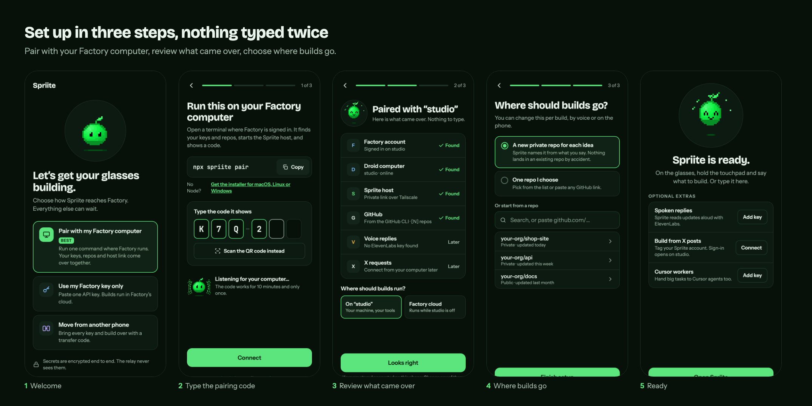

# Set up Spriite

This guide takes you from nothing to building from your glasses, one step at a time. Plan on
about 30 minutes for a first setup. After that, a new phone takes one transfer code.

[Back to the README](../README.md)



**The short version.** You run a small relay, install the Spriite host on your Factory computer,
build your own copy of the app against both, upload it to your Even Hub account, and pair. Pairing
moves every key from the computer to the phone, encrypted with a one-time code, so you never type a
secret on the phone.

| Step | Where | What you get |
|---|---|---|
| [0. Get ready](#0-get-ready) | Computer and phone | The tools and accounts below |
| [1. Deploy your relay](#1-deploy-your-relay) | Cloudflare (or your own server) | An `https://` relay URL |
| [2. Install the Spriite host](#2-install-the-spriite-host) | Your Factory computer | A private `https://…ts.net:47822` host URL |
| [3. Build your copy of the app](#3-build-your-copy-of-the-app) | Your Factory computer | `spriite.ehpk` |
| [4. Install it on the glasses](#4-install-it-on-the-glasses) | Even Hub portal and phone | Spriite in the Even app |
| [5. Pair](#5-pair-the-phone-with-your-computer) | Computer and phone | Every key on the phone |
| [6. Choose where builds go](#6-choose-where-builds-go) | Phone | Ready to build |

Only have a Factory API key and no computer to pair? Do steps 0, 1, 3 and 4, then follow
[Key only](#key-only-no-factory-computer).

### 0. Get ready

**Hardware**

- Even Realities **G2** glasses, paired with the Even Realities app on your phone. The **R1** ring
  is optional; the temple touchpads do the same.
- A **Factory computer**: a Linux or macOS machine you leave on while you build. Windows is not
  supported.

**Accounts**

- **Factory** ([factory.ai](https://factory.ai/)), with an API key
  (app.factory.ai → Settings → API keys).
- **GitHub**. New repositories are created with your own GitHub sign-in on the Factory computer.
- **Even Hub developer account** ([hub.evenrealities.com](https://hub.evenrealities.com/hub)), to
  upload your copy of the app.
- **Cloudflare** (free plan), for the relay. Any host that serves HTTPS works too.
- Optional: **ElevenLabs** (spoken replies), **Cursor** (extra cloud workers), an **X developer
  app** (start builds from X posts).

**On the Factory computer**, install and sign in to:

```bash
node --version            # 22 or newer (https://nodejs.org)
droid --version           # Factory's CLI; open it once and sign in
gh auth login             # GitHub CLI (https://cli.github.com); choose HTTPS
tailscale up              # Tailscale (https://tailscale.com/download)
```

**Tailscale** gives the phone a private HTTPS link to the computer, without opening a port to the
internet. In the Tailscale admin console, under DNS, turn on **MagicDNS** and **HTTPS
certificates**. Then install the **Tailscale app on your phone** and sign in to the same tailnet.
The phone must be on the tailnet whenever you use Spriite with your computer.

Get the code:

```bash
git clone <repository-url> spriite
cd spriite
npm install
```

### 1. Deploy your relay

Factory, Cursor and X don't accept requests from web pages they don't own, so Spriite needs a
small relay that forwards your requests and adds CORS headers. It lives in
[`relay/`](../relay/), logs nothing, and only talks to `api.factory.ai`, `api.cursor.com` and
`api.x.com` (read-only, plus the one OAuth token POST that renews your X token). It also holds the
pairing mailbox: a few minutes of ciphertext while your phone pairs, which the relay cannot read
([how pairing works](design/PAIRING-PROTOCOL.md)).

```bash
cd relay
npx wrangler login         # first time only
npx wrangler deploy        # prints https://spriite-relay.<you>.workers.dev
curl https://spriite-relay.<you>.workers.dev/health   # -> spriite relay ok
cd ..
```

Write the printed URL down: it is your **relay URL**. To run the relay on your own server or
tailnet instead, see [`relay/README.md`](../relay/README.md).

### 2. Install the Spriite host

The Spriite host (the [native broker](NATIVE-BROKER-SETUP.md)) runs on the Factory computer. It
runs builds as Factory Missions with your own tools, creates repositories with your GitHub sign-in,
and holds anything that should not live on the phone. It listens on loopback only; Tailscale gives
the phone a private HTTPS address for it.

Pick the Factory model ids builds may use (`droid` lists them), then install:

```bash
MODELS='["<model-id>"]' EXPOSE=tailscale bash scripts/install-native-broker.sh
```

The installer checks `droid`, `gh` and `git`, installs a per-user service (a LaunchAgent on macOS,
`systemd --user` on Linux), reads your Factory key from droid's login (or `FACTORY_API_KEY`), and
runs `tailscale serve` on port 47822. It ends by printing your **host URL**, for example
`https://<your-computer>.<your-tailnet>.ts.net:47822`. Write it down.

Check it from the phone's point of view: with the phone on the tailnet, opening
`<host URL>/v1/native/capabilities` in the phone's browser should answer `401` (it is there, and it
wants the token that pairing brings over).

### 3. Build your copy of the app

The Even app checks each build's network allowlist before any request leaves the phone, and it
accepts exact addresses only. That is why every owner builds their own copy with their own relay
and host URLs.

In the [Even Hub developer portal](https://hub.evenrealities.com/hub), create a project and note
its **package id** (for example `com.yourname.spriite`). Then:

```bash
cp .env.example .env.production.local     # git-ignored
```

Edit `.env.production.local`:

```bash
VITE_SPRIITE_RELAY=https://spriite-relay.<you>.workers.dev                # step 1
SPRIITE_PACKAGE_ID=com.yourname.spriite                                   # your project
SPRIITE_NATIVE_BROKER=https://<your-computer>.<your-tailnet>.ts.net:47822 # step 2
```

Build it:

```bash
npm run pack               # -> spriite.ehpk
```

The output lists the relay and host it allows. Bump `version` in `app.json` before each new
upload; Even Hub tells updates apart by version.

### 4. Install it on the glasses

Upload `spriite.ehpk` to your project in the Even Hub portal.

- A **private build** (Even app → Me → Apps → Private builds) is quickest for a first check.
- A **beta build** (move it to Test and add yourself to a beta group) keeps running with the phone
  locked, so use that every day.

Open Spriite in the Even app. Welcome offers **Pair with my Factory computer**, **Use my Factory key
only** and **Move from another phone**. Choose **Pair with my Factory computer**.

### 5. Pair the phone with your computer

On the Factory computer, in the `spriite` folder:

```bash
npm run pair -- --relay https://spriite-relay.<you>.workers.dev
```

(Once the `spriite` package is published, `npx spriite pair` does the same from anywhere.)

It reuses the host from step 2 and looks around the computer for:

| Item | Where it comes from |
|---|---|
| Factory account | `FACTORY_API_KEY`, the host's key file, or droid's login |
| Droid computer | Your Factory account's computer list |
| Spriite host | The private link from `tailscale serve` (or `SPRIITE_BROKER_URL`) |
| GitHub | `gh auth token` |
| Voice replies | `ELEVENLABS_API_KEY`, or a key saved on the host ([Optional extras](#optional-extras)) |
| X requests | An X token pair saved on the host ([Optional extras](#optional-extras)) |

It prints the list, then a 6-character code such as `K7Q-2MF` and a QR code. On the phone, type
the code (or scan the QR) and tap **Connect**. The code works once and expires after 10 minutes; if
it expires, run the command again for a new one.

The phone shows what came over. Anything marked **Later** can be added in **Settings**. Choose
where builds run: **On “your computer”** (your machine, your tools) or **Factory cloud** (runs while
the computer is off). Keys are stored encrypted on the phone.

Useful options: `--dry-run` prints the plan with every secret redacted and changes nothing;
`--no-install` never installs the host. The relay URL is remembered after the first run
(`~/.config/spriite/host.json` on Linux, `~/Library/Application Support/Spriite/host.json` on
macOS).

### 6. Choose where builds go

- **A new private repo for each idea** (the default): each build gets its own repository, named
  from what you said. With a paired host it is created with the computer's GitHub sign-in; the
  phone needs no GitHub token.
- **One repo I choose**: pick one from the list, or paste any GitHub link.

Tap **Finish setup**. Spriite is ready: on the glasses, hold the touchpad and say what to build,
or type it on the phone.

### Key only (no Factory computer)

Choose **Use my Factory key only** on Welcome and paste your Factory API key. Builds run in
Factory's cloud on a Droid Computer in your account (Factory app → Settings → Droid Computers →
Create, or your own machine running `droid daemon --remote-access`). For new repositories, add a
GitHub token in **Settings → GitHub** (a classic token with the `repo` scope, or a fine-grained
token with “Repository creation”). Build the app in step 3 without `SPRIITE_NATIVE_BROKER`.

### Optional extras

All of these can be added later. Anything saved on the Factory computer comes over the next time
you pair.

- **Spoken replies (ElevenLabs).** Either set `ELEVENLABS_API_KEY` when you run `npm run pair`, or
  save the key on the host once:

  ```bash
  # macOS; on Linux the folder is ~/.local/share/spriite/native-broker
  B="$HOME/Library/Application Support/Spriite/native-broker"
  (umask 077; printf '%s\n' '<your-elevenlabs-key>' > "$B/secrets/elevenlabs-api-key")
  ```

  Or add it on the phone in **Settings → Spoken replies**.
- **Build from X posts.** Register an X **Native App** (public PKCE client) with Read permissions
  and the callback `http://127.0.0.1:47823/x/callback`. Then sign in from the computer: in
  **Settings → X requests** tap **Connect**, and the sign-in opens on the computer (set the client
  id there, or `SPRIITE_X_CLIENT_ID` on the computer). If you already have a token pair for your
  app, save it on the host as `secrets/x-pair.json` (mode 0600) with the fields `clientId`,
  `accessToken` and `refreshToken`; the next pairing moves it to the phone and deletes the host
  copy, because X rotates the pair on every renewal. Then set Spriite's own X handle and launch
  options in **Settings → X requests**. Details: [`X-INTAKE-HANDOFF.md`](X-INTAKE-HANDOFF.md).
- **Cursor workers.** Hand big tasks to Cursor agents too: add a Cursor key in **Settings →
  Cursor**.

### Move to another phone

**Settings → Your setup → Move to another phone** shows a one-time code such as `WREN · 41 · OAK`
and a QR code that expires in 10 minutes. On the new phone, open Spriite and choose **Move from
another phone**. Every key and the link to your computer, build defaults and repo choices, and build
history move, encrypted with the code before they leave the phone. An X sign-in held on the phone
does not move (X rotates it on every renewal, so it cannot live on two phones); reconnect X from
the computer.

### Keep a Factory computer online

Factory runs every session on a Droid Computer. With **On “your computer”**, builds run as Factory
Missions on your computer through the Spriite host; with **Factory cloud**, Spriite uses the
computer you paired (when active) or the first active computer in your account. `droid computer
list` shows what Factory sees. If a computer is listed but its daemon is not connected, the glasses
show **Computer offline** and the phone explains why.

### Advanced

Factory-native details (models per job, tools, acceptance checks), relay and host addresses, and
durable runtime and developer flags are under **Settings › Advanced**, prefilled from pairing.

### Try it without a relay

For development, the dev server proxies Factory, Cursor and X itself, and the pairing mailbox to a
local relay (`npm run relay`, or `SPRIITE_DEV_RELAY`):

```bash
npm run relay &                               # local relay on 127.0.0.1:8787 (pairing mailbox)
npm run dev                                   # http://localhost:5173
npm run pair -- --relay http://127.0.0.1:8787 # on the computer, in a checkout
npx evenhub qr --url http://<your-lan-ip>:5173   # scan with the glasses' phone app
```

The phone and the dev machine must share a network. This mode stops when the phone locks, so use a
relay build for real use.
